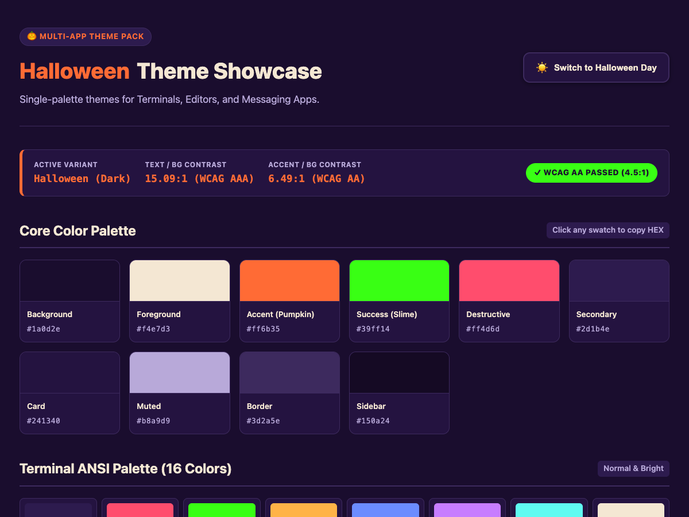

# Orca Halloween Theme

A Halloween-themed color set for Orca (stablyai/orca), modern terminals, editors, and messaging apps.

[](https://github.com/kichiemon/halloween-theme-pack/actions/workflows/release.yml)



Open `preview/index.html` in your browser for an **interactive live preview** with light/dark toggle, clickable palette swatches, and terminal/app mockups (pure HTML/CSS/JS, zero dependencies).

---

## 🎨 Palettes

### 1. Halloween (Night / Dark)
High-contrast deep purple night with pumpkin orange, slime green, and blood red accents.

| Role | Hex | Notes |
|---|---|---|
| Background (deep purple night) | `#1a0d2e` | Base background |
| Foreground (bone) | `#f4e7d3` | Contrast 15.09:1 (WCAG AAA) |
| Accent (pumpkin) | `#ff6b35` | Primary brand & active elements |
| Success (slime green) | `#39ff14` | High-visibility status & commands |
| Destructive (blood red) | `#ff4d6d` | Errors & warnings |
| Secondary | `#2d1b4e` | Toolbars & active tabs |
| Card / Panel | `#241340` | Surface cards |
| Muted (dusty lilac) | `#b8a9d9` | Comments & line numbers |
| Border | `#3d2a5e` | Dividers |
| Sidebar | `#150a24` | Side navigation panels |

### 2. Halloween Day (Light)
Warm cream parchment background with deep purple typography, pumpkin orange accent, and forest/witch green accents. Fully WCAG AA compliant (4.5:1+ text contrast).

| Role | Hex | Notes |
|---|---|---|
| Background (warm cream) | `#faf4eb` | Base background |
| Foreground (dark purple) | `#241432` | Contrast 15.73:1 (WCAG AAA) |
| Accent (rich pumpkin) | `#bf4904` | Contrast 4.61:1 (WCAG AA Pass) |
| Success (witch green) | `#1b772d` | Contrast 5.16:1 (WCAG AA Pass) |
| Destructive (blood crimson) | `#b81438` | Contrast 6.01:1 (WCAG AA Pass) |
| Secondary | `#e8dcce` | Surface & active backgrounds |
| Card | `#f2e7d8` | Elevated containers |
| Muted | `#756388` | Contrast 5.00:1 (WCAG AA Pass) |
| Border | `#d8c8b4` | Parchment borders |
| Sidebar | `#f4ece1` | Side navigation panels |

---

## 📁 Generated Files

Generated via `generate.py` (or the pre-built `bin/halloween-gen` binary):

### Dark Mode (`themes/`)
- **Terminals**:
  - `themes/terminal/halloween.yaml` — Warp / Orca
  - `themes/terminal/halloween.itermcolors` — iTerm2
  - `themes/terminal/halloween.ghostty` — Ghostty
  - `themes/terminal/halloween.alacritty.toml` — Alacritty
  - `themes/terminal/halloween.wezterm.toml` — WezTerm
  - `themes/terminal/halloween.kitty.conf` — kitty
  - `themes/terminal/halloween.windows-terminal.json` — Windows Terminal
  - `themes/terminal/halloween.hyper.js` — Hyper terminal module
  - `themes/terminal/halloween.tabby.yaml` — Tabby
  - `themes/terminal/halloween.rio.toml` — Rio terminal
- **Editor**:
  - `themes/editor/halloween-vscode.json` — VS Code
- **Apps**:
  - `themes/app/halloween-slack.txt` — Slack theme string
  - `themes/app/halloween-discord.css` — Discord (BetterDiscord)
  - `themes/app/halloween.tmux.conf` — tmux
  - `themes/app/halloween.zsh` — zsh prompt & syntax highlighting

### Light Mode (`themes/light/`)
- `themes/light/halloween-light.yaml` — Warp / Orca
- `themes/light/halloween-light.itermcolors` — iTerm2
- `themes/light/halloween-light.ghostty` — Ghostty
- `themes/light/halloween-light.alacritty.toml` — Alacritty
- `themes/light/halloween-light.wezterm.toml` — WezTerm
- `themes/light/halloween-light.kitty.conf` — kitty
- `themes/light/halloween-light.windows-terminal.json` — Windows Terminal
- `themes/light/halloween-light.hyper.js` — Hyper terminal module
- `themes/light/halloween-light.tabby.yaml` — Tabby
- `themes/light/halloween-light.rio.toml` — Rio terminal
- `themes/light/halloween-light-vscode.json` — VS Code
- `themes/light/halloween-light-slack.txt` — Slack theme string
- `themes/light/halloween-light-discord.css` — Discord (BetterDiscord)
- `themes/light/halloween-light.tmux.conf` — tmux
- `themes/light/halloween-light.zsh` — zsh prompt & syntax highlighting

### Orca (UI & Root)
- `halloween.yaml` — Terminal theme (Warp format, synchronized with canonical dark theme)
- `halloween.css` — App UI theme (chat/sidebar/panels) as CSS variable overrides

---

## 🚀 Quick Start

Download `bin/halloween-gen` (or grab cross-platform binaries from [GitHub Releases](https://github.com/kichiemon/halloween-theme-pack/releases)):

```bash
./bin/halloween-gen            # writes to ./themes/
./bin/halloween-gen --out DIR  # custom output dir
```

No Python required — single self-contained binary.

---

## 🔧 Regenerate & Validate (from source)

```bash
# Generate theme files
python3 generate.py            # writes to ./themes/
python3 generate.py --out DIR  # custom output dir

# Run validation suite
python3 validate.py            # validates all generated theme files
```

### Validation Suite (`validate.py`)
Checks:
- **WCAG AA Contrast**: Verifies foreground/background and accent pairs meet $\ge 4.5:1$ text contrast ratio.
- **Theme Name Uniqueness**: Ensures no collisions across variants.
- **Hex Syntax**: Strict validation of `#RGB` / `#RRGGBB` format across all generated files.
- **Required Fields**: Verifies structure for all 15 formats (YAML, TOML, JSON, XML, CSS, etc.).

### Building the Single Binary
```bash
python3 -m venv .venv
.venv/bin/pip install pyinstaller
.venv/bin/pyinstaller --onefile --name halloween-gen generate.py
cp dist/halloween-gen bin/
```

---

## 📦 Installation Guide

- **Orca terminal**: Settings → Appearance → Terminal → Import from YAML → pick `halloween.yaml` (or `themes/light/halloween-light.yaml`).
- **iTerm2**: Preferences → Profiles → Colors → Color Presets → Import → pick `.itermcolors`.
- **Ghostty**: Copy `halloween.ghostty` or `halloween-light.ghostty` into `~/.config/ghostty/themes/` and set `theme = halloween`.
- **Alacritty**: Import into `~/.config/alacritty/alacritty.toml` via `import = ["path/to/theme.toml"]`.
- **WezTerm**: Include in `colors` within `~/.wezterm.lua`.
- **kitty**: Include in `~/.config/kitty/kitty.conf` via `include path/to/kitty.conf`.
- **Windows Terminal**: Add scheme object from `.windows-terminal.json` to the `schemes` array in `settings.json`.
- **Hyper**: Place `halloween.hyper.js` into `~/.hyper_plugins/local/` and add to `localPlugins` in `.hyper.js`.
- **Tabby**: Paste the contents of `.tabby.yaml` under `terminal.colorScheme` in `config.yaml`.
- **Rio terminal**: Copy `.rio.toml` to `~/.config/rio/themes/` and set `theme = "halloween"`.
- **VS Code**: Place `*-vscode.json` under `~/.vscode/extensions/` or load as a custom color theme.
- **Slack**: Paste the comma-separated string from `halloween-slack.txt` into Preferences → Themes → Custom.
- **Discord**: Apply `*-discord.css` in BetterDiscord custom CSS settings.
- **tmux**: Add `source-file /path/to/halloween.tmux.conf` in `~/.tmux.conf`.
- **zsh**: Source `halloween.zsh` in your `~/.zshrc`.

---

## 🌐 Interactive Preview

Open `preview/index.html` directly in any web browser to explore:
- Interactive Dark ("Halloween Night") and Light ("Halloween Day") variants.
- Live palette color swatches with one-click hex copying.
- Terminal mockup with ANSI 16-color test pattern and realistic prompt.
- VS Code editor mockup with syntax token highlighting.
- Discord / Slack messaging UI mockup with channels and reactions.
- Tmux statusline preview.

---

## 📄 License

[MIT](LICENSE) — Copyright (c) 2026 kichiemon. Feel free to fork, remix, and redistribute.

---

## ⚠️ Disclaimer

The app UI theme (`halloween.css`) overrides Orca's internal CSS custom properties, which are implementation details and may change between Orca versions. It is unofficial and provided as-is. The terminal themes (Warp YAML and other formats) use stable, documented formats and are safe to use.
